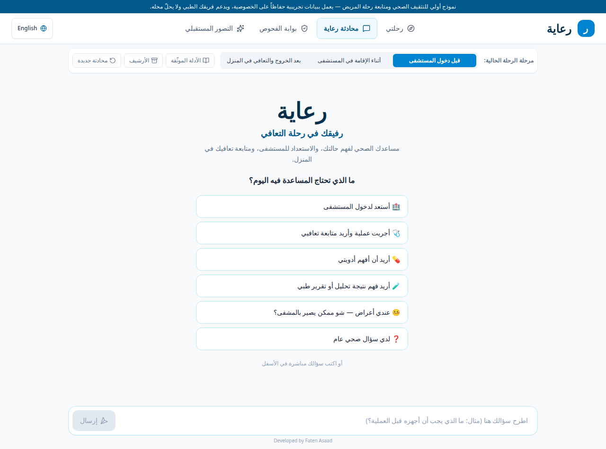
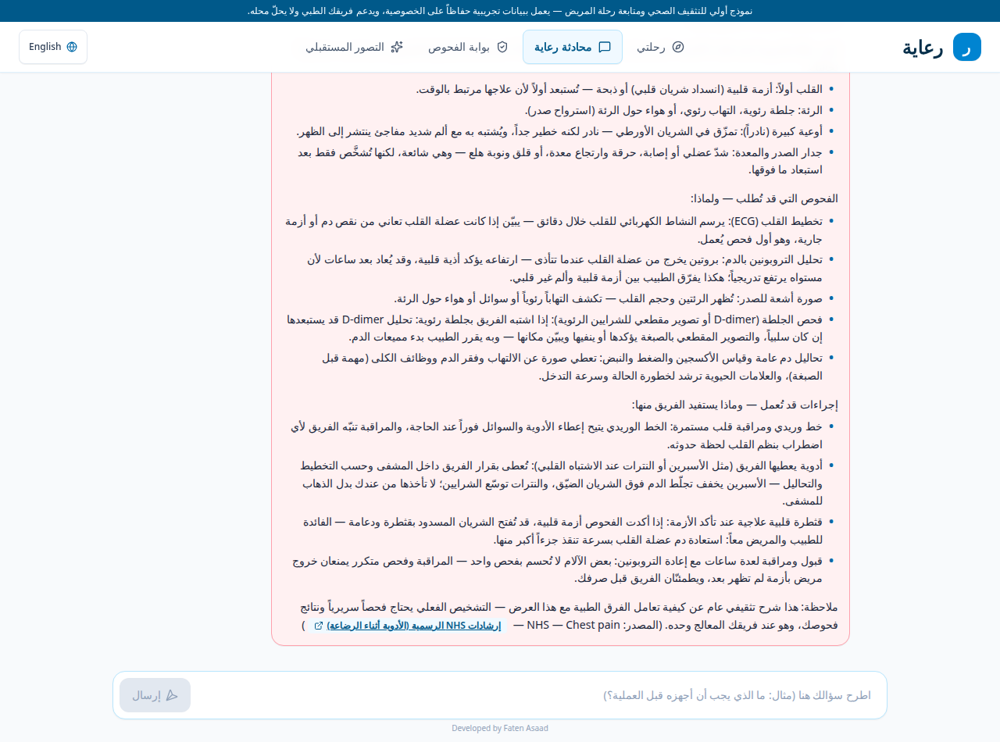
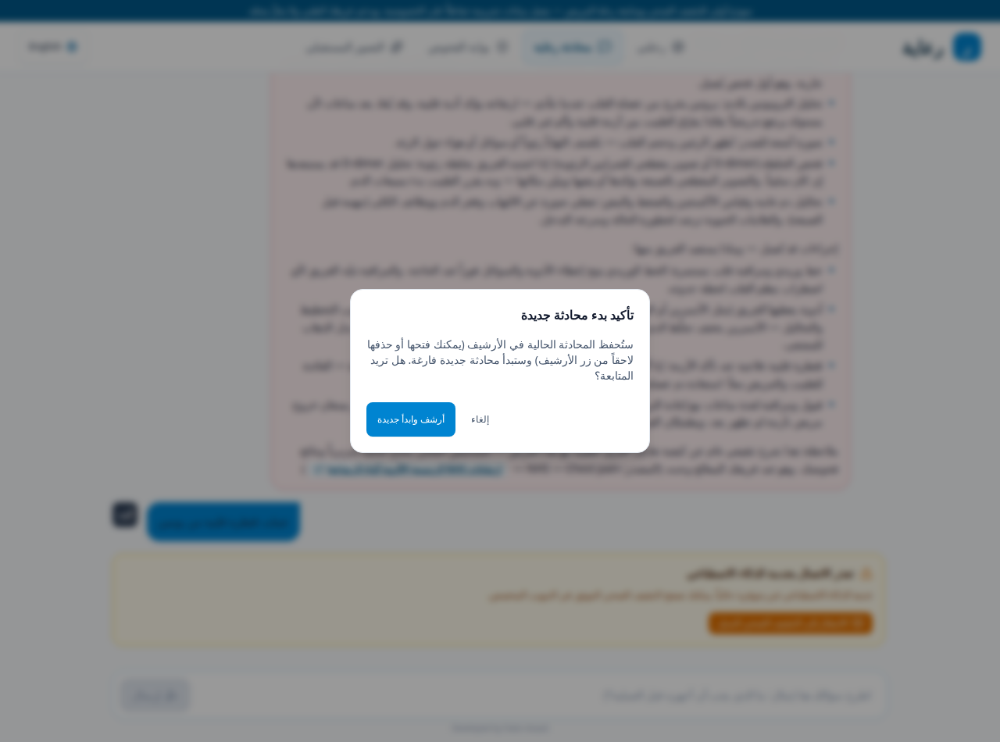
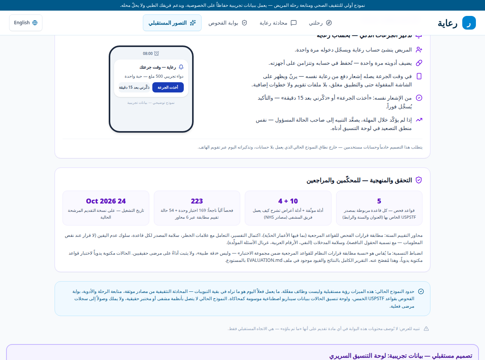

# Riaya (رعاية) — the companion that explains why

Riaya is a bilingual (Arabic-first, English) health companion that walks a patient through the whole hospital journey — preparing for admission, the stay, and recovery at home after discharge — and **explains the reason behind everything it asks or shows**: why this screening is recommended, why this follow-up question matters, why this test is ordered, what happens next.

**Riaya is an educational prototype running on synthetic demo data only. It does not diagnose, does not replace the patient's medical team, and is not connected to any real hospital system.**

Developed by **Faten Asaad** — informatics engineer with ten years of intensive-care experience. Built for the GenAI Works Open Agent Hackathon, **Track 02: "The Agent That Can Explain Why"**.



---

## The problem

Two gaps hurt patients quietly:

1. **After discharge**, patients go home with instructions they barely understand. They cannot tell a normal recovery day from an early warning sign, and nobody explains *why* they are being asked to watch for specific things.
2. **After screening**, a result that needs follow-up can simply vanish — issued but never reviewed, with no named owner and no deadline. The gap between "screening done" and "care received" is where harm hides.

Riaya's answer to both is the same: **never present a bare instruction — always show the reason, the source, and the next step.**

## What Riaya does today

| Area | What the patient gets |
|---|---|
| **Intake chat** | A welcome that routes by intent: preparing for admission, post-operation follow-up, medications, lab results, or symptoms — in the patient's own words, Arabic or English. |
| **Journey follow-up** | A daily recovery check-in (11 core questions) plus procedure-specific question sets (thyroid, caesarean, cardiac catheterization, gallbladder). **Every question carries "Why we ask" and "What to do"** — the clinical reason, in plain language, and the action if it applies. A "yes" on a danger question raises an **instant alert**, not a note in a summary. |
| **Any other operation** | The model may only generate *monitoring questions* (yes/no), validated by a strict parser with a content screen — no digits, no thresholds, no treatment phrasing — labelled "general generated questions, not a verified protocol". Anything invalid falls back to sourced prose guidance. |
| **Verified general FAQ** | Ten high-frequency general questions (diabetes, hypertension, fever, antibiotics, anaesthesia fasting, cholesterol, dehydration, vaccines, paracetamol, wound first aid), each answered deterministically from one NHS source that was opened and read; question-shaped matching only — personal statements about the user's own case never match. |
| **Symptom guides** | For 21 symptoms (chest pain, breathlessness, abdominal pain, flank pain, toothache, hand/wrist pain, headache, back pain, sore throat, cough, dizziness, diarrhoea & vomiting, constipation, urinary infection, heartburn/reflux, leg swelling, earache, palpitations, pins & needles, itchy skin, tiredness): the emergency action first, then **how a hospital team thinks** — cause categories most-dangerous-first, which tests they order **and why**, which procedures may follow **and what the team gains from each**. Each guide is structured from the single NHS page it names. Education about the process — never a personal diagnosis or a ranked differential. |
| **Lab results** | A deterministic explainer: it asks which test, reads Arabic-Indic digits and units, converts units, compares the value with published general ranges, explains generally (including common causes of high/low), and closes with "this is not a diagnosis — ask your doctor". Uncovered tests are answered honestly, with the covered list. |
| **Screening gateway** | A 7-question wizard over **5 USPSTF rules**, each decision delivered with an **evidence trace** («ورّيني الدليل» — "Show me the evidence"): the facts used, the rule, the reasoning, the limits, the missing inputs, and the source — or an explicit "insufficient information, no recommendation issued" naming what is missing. Each trace also answers **"what could change this result?"** with changes verified by re-running the engine on modified inputs — never asserted from thresholds by hand. Ten verified guides live one tap away in the same gateway. |
| **Future vision** | A design board (clearly labelled simulation, synthetic cases) for closing the screening-to-care loop: every case has a named owner, an SLA clock, documented escalation, and documented closure — including the honest rule that a result stays "awaiting review" until a review event actually arrives. |




## Architecture — a deterministic pipeline, not a black box

Riaya is deliberately **not** an autonomous agent that improvises medical content. It is a pipeline of specialised, inspectable components; the language model is confined to the surfaces where generation is safe, and everything safety-relevant is deterministic code.

```
 patient text
     │
     ├─► Red-flag detector (AR + Levantine + EN, negation guard)
     │        └─ urgent ─► emergency guidance leads the reply
     ├─► Symptom-guide matcher ─► fixed NHS-grounded guides (no model)
     ├─► Lab explainer ─► verified ranges, digit/unit parsing (no model)
     ├─► Screening engine ─► 5 USPSTF rules ─► Explain pipeline
     │        └─ evidence trace: facts · rule · source · limits · missing inputs
     ├─► Follow-up questions
     │        ├─ curated sets (hand-written why/action)
     │        └─ generated sets ─► strict validator + content screen
     │              └─ invalid ─► sourced prose fallback
     └─► Chat ─► verified-source gate
              ├─ covered topic ─► model answer (Gemini), sources only
              └─ not covered ─► explained refusal + pointer to the guides
```

### Deterministic vs generated — the boundary, explicitly

| Deterministic (code, tested) | Generated (model, constrained) |
|---|---|
| Screening decisions and their evidence traces | Free-text chat answers on source-covered topics only |
| Red-flag detection and escalation wording | Follow-up *question wording* for unlisted operations — then validated; never severity, never advice |
| Symptom guides, lab explanations, why/action texts | — |
| Instant alerts, SLA/escalation logic on the board | — |

## Verified sources

Every medical claim traces to a published source; the engine binds **each rule to its own authority** (title, year, URL — copied into the evidence trace, never generated):

| Domain | Source |
|---|---|
| Colorectal screening | USPSTF 2021 |
| Breast screening | USPSTF 2024 |
| Diabetes screening | USPSTF 2021 |
| Hypertension screening | USPSTF 2021 |
| Lung screening | USPSTF 2021 |
| Caesarean recovery | NICE NG192 |
| Recovery after surgery, gallbladder, chest pain, breathlessness, kidney stones | NHS |
| Lab reference ranges | MedlinePlus / Cleveland Clinic |

## Safety design

- Red-flag answers **lead** with the emergency action.
- The system **refuses to guess**: missing inputs produce "insufficient information" naming the missing fields; uncovered questions produce an explained refusal, not an improvised answer.
- The model **never** diagnoses, never assigns severity, and never explains risk — risk explanations live in fixed, reviewed text banks.
- All demo data is synthetic and labelled; there are no accounts and no personal records in this prototype.

## Run it

```bash
npm install --legacy-peer-deps
# set GEMINI_API_KEY in .env (chat and question generation use it;
# the deterministic flows — screening, guides, labs — work without it)
npm run dev        # tsx server.ts → http://localhost:3000
npm run build      # production build
npm run lint       # tsc --noEmit (strict)
```

## Tests & evaluation

428 automated checks pass on this build (24 Oct 2026): **374 unit tests** across eight suites plus a **54-case conformance evaluation** across six axes (decision conformance incl. boundary values, explanation completeness, red-flag handling, per-rule source integrity, uncertainty behaviour, input safety). The v7 Evidence Comparator (multi-source comparison over a curated pre-loaded pack — USPSTF vs ADA for diabetes, USPSTF vs ACS for colorectal, relations computed from documented scopes) has its own separate suite: **18 / 18 passing**, reported separately and never merged into the 428.

```bash
for t in explain-agent v4-features generated-questions lab-reference question-why symptom-guides general-faq evaluation-suite; do
  npx esbuild tests/$t.test.ts --bundle --platform=node --format=cjs --outfile=/tmp/$t.cjs --log-level=error && node /tmp/$t.cjs
done
```

Full methodology, results, and an honest limitations list: **[EVALUATION.md](EVALUATION.md)**.



## Known limitations

- Phrase-matching red-flag detection with a deliberately narrow negation/dialect scope; ambiguous phrasing is escalated to the model with an urgent instruction, never dismissed.
- Generated follow-up questions occasionally fail validation with live model output and fall back to prose — by design, and disclosed in the UI when it happens.
- No real users yet; nothing in this repository is evidence of clinical benefit.
- The future-vision board is a design simulation. It must never be described as an operating system.

## Credits

Designed and developed by **Faten Asaad**. Clinical framing from a decade of intensive-care practice; engineering from her informatics degree. The interface shows رعاية in Arabic and Riaya in English — never combined.
